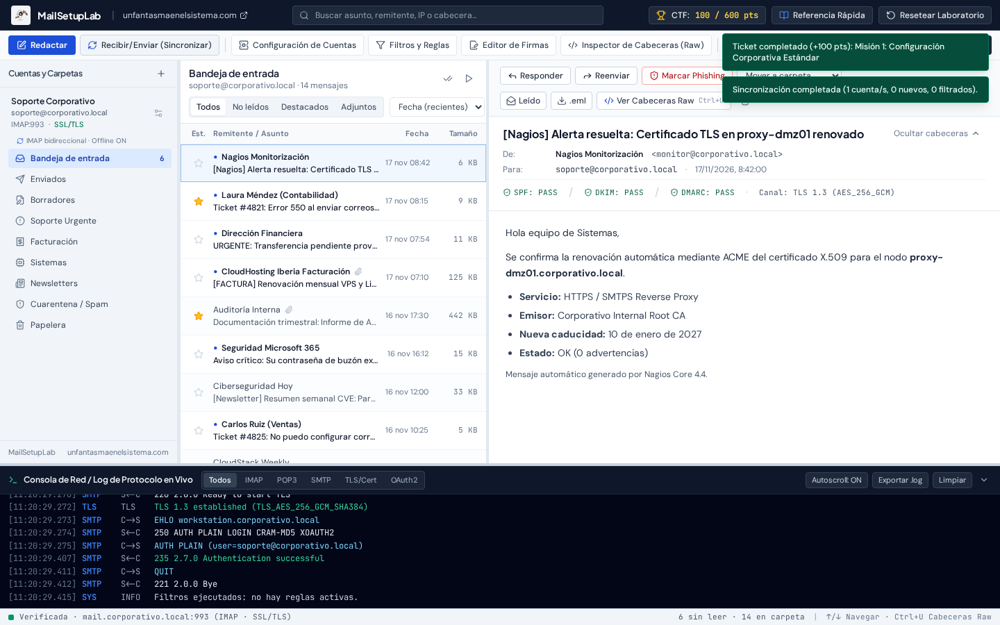
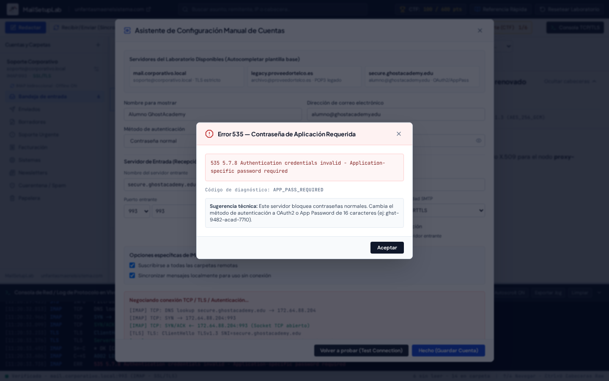
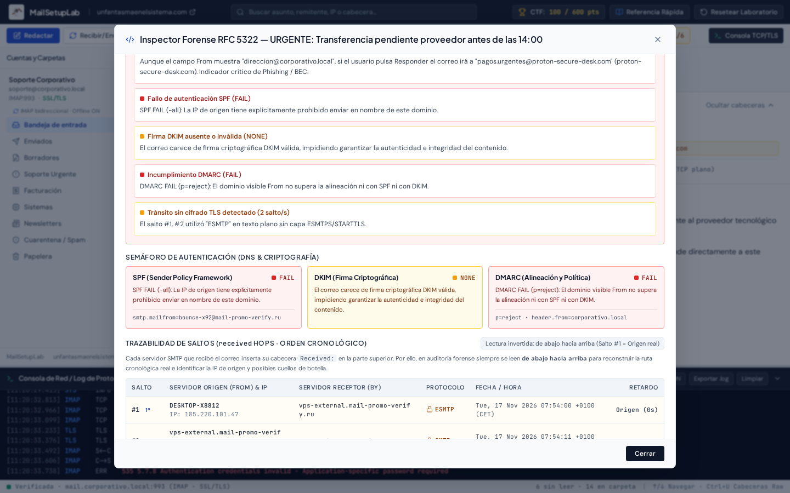
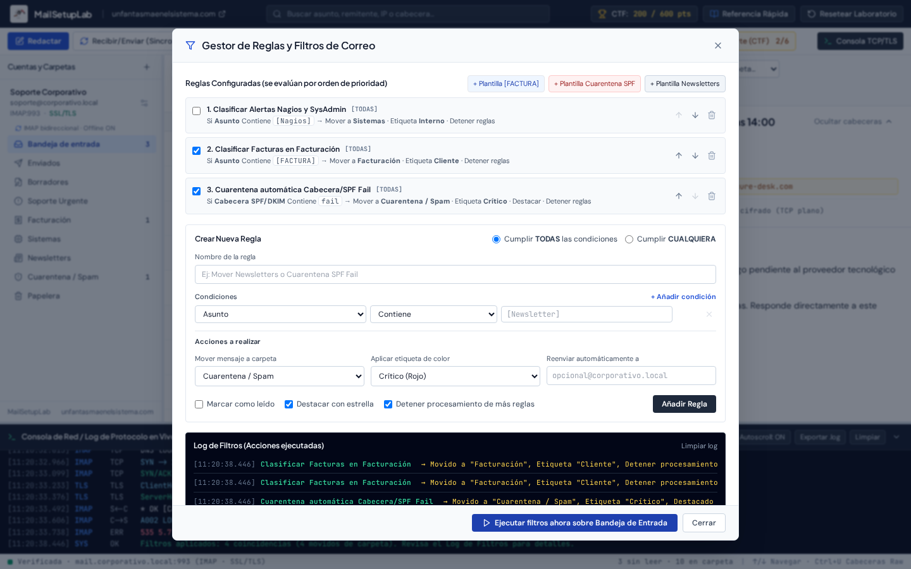
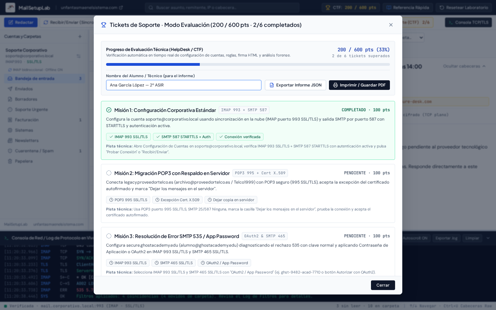
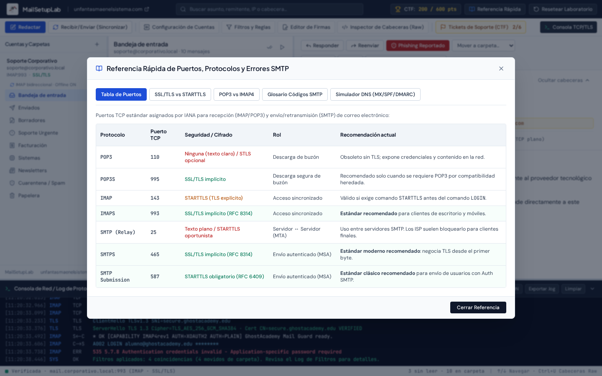
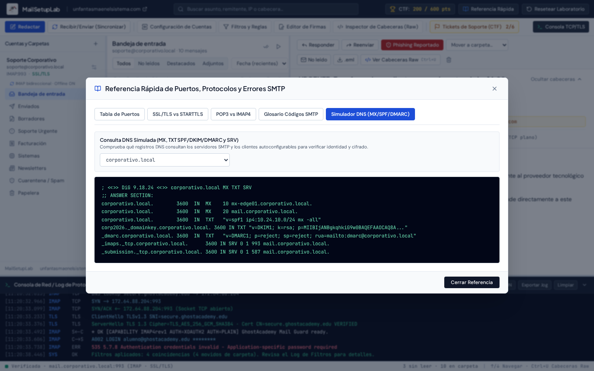

# MailSetupLab — Simulador Educativo de Cliente de Correo y Protocolos

[](#arquitectura-y-despliegue)
[](#despliegue-en-github-pages)
[](#capacidades-del-simulador)
[](LICENSE)

**MailSetupLab** es un laboratorio interactivo de escritorio en el navegador (inspirado en **Mozilla Thunderbird 115 Supernova** y **Microsoft Outlook clásico**) diseñado para formación técnica en administración de sistemas, redes y ciberseguridad (ASIR, DAW, SMR, Certificados de Profesionalidad y talleres HelpDesk).

Funciona **100 % en el lado del cliente** dentro de un único `index.html` autocontenido, sin backend ni dependencias de servidor, con persistencia local en `localStorage` y botón de reseteo completo del laboratorio.

> Proyecto vinculado a [unfantasmaenelsistema.com](https://www.unfantasmaenelsistema.com/).

---

## Capturas Reales de la Aplicación

### 1. Escritorio de 3 Paneles, Barra de Estado y Consola TCP/TLS en Vivo


### 2. Asistente Manual de Cuentas y Diagnóstico Real de Errores (Error 535 / TLS / Certificados)


### 3. Inspector y Analizador Forense de Cabeceras RFC 5322 (`Ctrl+U`)


### 4. Motor Multi-Condición de Reglas y Filtros Automáticos


### 5. Tickets HelpDesk · Modo Evaluación Gamificado (CTF) e Exportación JSON/PDF


### 6. Referencia Rápida de Puertos, Protocolos, Códigos SMTP y Simulador DNS
| Tabla de Puertos, TLS vs STARTTLS, POP3 vs IMAP4 y Códigos SMTP | Simulador DNS (`MX`, `SPF`, `DKIM`, `DMARC`, `SRV`) |
| :---: | :---: |
|  |  |

---

## Capacidades del Simulador

1. **Interfaz de Cliente de Correo de Escritorio (3 Paneles Redimensionables + Barra de Estado):**
   - **Panel izquierdo:** Árbol de cuentas configuradas y carpetas (`Bandeja de entrada`, `Enviados`, `Borradores`, `Soporte Urgente`, `Facturación`, `Sistemas`, `Newsletters`, `Cuarentena / Spam`, `Papelera`), con indicador de sincronización IMAP vs almacenamiento local POP3.
   - **Panel central:** Lista de mensajes con búsqueda global instantánea (asunto, remitente, IP o cabecera raw), filtros rápidos (`Todos`, `No leídos`, `Destacados`, `Adjuntos`), ordenación y navegación con teclado (`↑` / `↓`).
   - **Panel derecho:** Vista previa del mensaje con cabeceras colapsables, estado `SPF / DKIM / DMARC`, descarga de mensaje en formato **`.eml` (RFC 5322)**, visor seguro de adjuntos y acceso directo a **Ver Cabeceras Raw (`Ctrl+U`)**.
   - **Consola de Red / Log de Protocolo en Vivo:** Panel inferior redimensionable y filtrable (`IMAP`, `POP3`, `SMTP`, `TLS/Cert`, `OAuth2`) que traza en tiempo real handshakes TCP, negociación TLS 1.3 / STARTTLS, comandos (`EHLO`, `AUTH PLAIN`, `CAPA`, `STAT`, `RETR`, `DELE`, `UID FETCH`) y códigos de respuesta (`220`, `250`, `354`, `502`, `530`, `535`, `550`), con exportación a `.log`.

2. **Asistente Manual de Cuentas y Motor Realista de Errores:**
   - Soporte completo para `IMAP` (`143`/`993`) vs `POP3` (`110`/`995`) y salida `SMTP` (`25`/`465`/`587`/`2525`).
   - Opciones reales dependientes de protocolo: retención en servidor POP3 (*"Dejar los mensajes en el servidor"*, borrado tras X días o al vaciar bandeja) vs suscripción y caché offline en IMAP.
   - Simulación exacta de fallos reales: `SSL_ERROR_RX_RECORD_TOO_LONG` por desajuste de puerto/TLS, cruce `IMAP`/`POP3`, alerta de certificado X.509 caducado (`SEC_ERROR_UNKNOWN_ISSUER`) con excepción manual, rechazo `535 5.7.8` por autenticación básica deshabilitada, flujo **OAuth2** / **App Password (16 caracteres)** y errores SMTP `502`/`550`.

3. **Motor de Filtros, Editor Dual de Firmas y Redacción SMTP:**
   - Reglas combinables (`Cumplir TODAS` / `CUALQUIERA`) con múltiples condiciones (`De`, `Para`, `Asunto`, `Cuerpo`, `Cabecera SPF/DKIM`, `Tamaño KB`, `Adjuntos`) y acciones (`Mover a carpeta`, `Etiqueta de color`, `Marcar como leído`, `Destacar`, `Reenviar`, `Detener procesamiento`), prioridad reordenable y Log de Filtros.
   - Editor de firmas HTML con pestaña **Visual** y **HTML Puro**, separador RFC estándar `-- `, inclusión configurable en nuevos correos o respuestas y selector `HTML + Texto plano (multipart/alternative)` vs `Solo Texto Plano`.
   - Ventana **Redactar / Responder / Reenviar** con validación SMTP real antes de enviar el mensaje.

4. **Inspector y Analizador Forense de Cabeceras RFC 5322 (`Ctrl+U`):**
   - **Análisis Desglosado:** Trazabilidad cronológica de saltos `Received:` (leídos **de abajo hacia arriba** con cálculo de retardo en segundos `+Xs` por salto), semáforo `SPF` / `DKIM` / `DMARC`, y detector automático de discrepancias (`From` vs `Return-Path`, `Reply-To` externo sospechoso, typosquatting, saltos sin TLS).
   - **Código Fuente Raw:** Vista completa de cabeceras MIME/RFC 5322 con copia al portapapeles.
   - **Analizador Libre de Cabeceras:** Área de texto para pegar cabeceras reales de Thunderbird, Gmail (*"Mostrar original"*) u Outlook y diseccionarlas en clase.

5. **Modo Evaluación (6 Tickets HelpDesk / CTF) + Chuleta Técnica + DNS:**
   - 6 tickets evaluados automáticamente en tiempo real (600 puntos totales), incluyendo formulario de reporte forense de phishing (IP real del atacante, dominio en `Reply-To` y resultado `SPF`).
   - Exportación de **Informe de Práctica Completada** en **JSON** o **Impresión / PDF** con el nombre del alumno y el desglose de requisitos superados.
   - **Referencia Rápida** integrada con tabla de puertos, `SSL/TLS` vs `STARTTLS`, `POP3` vs `IMAP4`, glosario de códigos SMTP y **Simulador DNS (`MX`, `TXT SPF/DKIM/DMARC`, `SRV`)**.

---

## Servidores Simulados Disponibles en el Laboratorio

| Servidor | Protocolo Soportado | Puertos y Seguridad | Credenciales de Prueba | Escenario Pedagógico |
| :--- | :--- | :--- | :--- | :--- |
| `mail.corporativo.local` | IMAP + SMTP | IMAP `993` (`SSL/TLS`) o `143` (`STARTTLS`) · SMTP `587` (`STARTTLS`) / `465` (`SSL/TLS`) | `soporte@corporativo.local`<br/>`Admin2026!` | Entorno corporativo estricto con TLS obligatorio y SPF/DKIM/DMARC activos. |
| `legacy.proveedortelco.es` | POP3 + SMTP (sin IMAP) | POP3 `995` (`SSL/TLS`, cert. caducado) o `110` (texto plano) · SMTP `25` / `587` (`Ninguna`) | `archivo@proveedortelco.es`<br/>`Telco1999` | Auditoría de servidor heredado: rechazo IMAP, aviso X.509 caducado y gestión de copia POP3 en servidor. |
| `secure.ghostacademy.edu` | IMAP + SMTP | IMAP `993` (`SSL/TLS`) · SMTP `465` (`SSL/TLS`) / `587` (`STARTTLS`) | `alumno@ghostacademy.edu`<br/>App Pass: `ghst-9482-acad-7710` o **OAuth2** | Diagnóstico del error `535 5.7.8` cuando se usa contraseña normal y migración a OAuth2 / App Password. |

---

## Tickets de Evaluación (600 pts)

1. **Misión 1 — Configuración Corporativa Estándar (100 pts):** Verificar `soporte@corporativo.local` con `IMAP 993 SSL/TLS` + `SMTP 587 STARTTLS` y autenticación activa.
2. **Misión 2 — Migración POP3 con Respaldo en Servidor (100 pts):** Conectar `legacy.proveedortelco.es` con `POP3 995 SSL/TLS`, aceptar la excepción del certificado caducado y marcar *"Dejar los mensajes en el servidor"*.
3. **Misión 3 — Resolución de Error SMTP 535 / App Password (100 pts):** Conectar `secure.ghostacademy.edu` con `IMAP 993 SSL/TLS`, `SMTP 465 SSL/TLS` y autenticación `OAuth2` o `App Password`.
4. **Misión 4 — Automatización con Reglas de Correo (100 pts):** Crear y ejecutar dos reglas activas: mover mensajes con `[FACTURA]` en el asunto a **Facturación** y enviar correos con fallos/remitente sospechoso a **Cuarentena / Spam**.
5. **Misión 5 — Identidad Corporativa (100 pts):** Configurar firma HTML (nombre, departamento y separador `-- `) para la cuenta corporativa y enviar un correo válido pasando la validación SMTP.
6. **Misión 6 — Caza de Phishing Forense (100 pts):** Analizar las cabeceras RFC 5322 de un correo suplantado en la bandeja de entrada y enviar en el formulario del ticket su IP real de origen, el dominio oculto en `Reply-To` y el resultado `SPF`.

<details>
<summary><strong>Guía rápida para docentes (soluciones de referencia de la Misión 6)</strong></summary>

- **Correo `msg_03` (*Dirección Financiera — URGENTE: Transferencia pendiente...*):**
  - IP real del atacante (`X-Originating-IP` / primer `Received`): `185.220.101.47` (relay externo: `193.142.88.19`)
  - Dominio oculto en `Reply-To`: `proton-secure-desk.com`
  - Resultado `SPF`: `FAIL`
- **Correo `msg_05` (*Seguridad Microsoft 365 — Aviso crítico...*):**
  - IP real del atacante (`X-Originating-IP` / primer `Received`): `45.134.212.90` (relay externo: `194.82.14.77`)
  - Dominio oculto en `Reply-To`: `vps-194-82.hosted-node.net`
  - Resultado `SPF`: `SOFTFAIL`

</details>

---

## Atajos de Teclado

| Atajo | Acción |
| :--- | :--- |
| `Ctrl + U` / `Cmd + U` | Abrir **Inspector Forense RFC 5322** del correo seleccionado (o Analizador Libre si no hay selección). |
| `↑` / `↓` | Navegar al mensaje anterior o siguiente de la lista activa. |
| `Esc` | Cerrar ventana modal o diálogo de alerta activo. |

---

## Arquitectura y Despliegue en GitHub Pages

Todo el simulador reside en **`index.html`** utilizando HTML5, Tailwind CSS (CDN), Lucide Icons (CDN) y JavaScript modularizado en memoria (`AppState` + `localStorage`).

### Opción A — Despliegue directo en GitHub Pages (Recomendado, sin compilación)
1. Sube este repositorio a GitHub.
2. Ve a **Settings → Pages** en tu repositorio.
3. En **Build and deployment → Source**, selecciona **Deploy from a branch**.
4. Elige la rama **`main`** y la carpeta **`/ (root)`**, y pulsa **Save**.
5. El archivo `.nojekyll` incluido asegura que todos los recursos estáticos se sirvan sin alteraciones. En segundos tendrás tu laboratorio online en `https://<tu-usuario>.github.io/<tu-repo>/`.

### Opción B — Entorno local o build con Vite
```bash
npm install
npm run dev       # Servidor local en http://localhost:3000
npm run build     # Genera la carpeta dist/ lista para hosting estático
```

---

## Estructura del Repositorio

```text
.
├── index.html                  # Aplicación completa autocontenida (UI + motores IMAP/POP3/SMTP/DNS/RFC5322/CTF)
├── public/assets/aistudio/     # Logotipo corporativo
├── docs/screenshots/           # Capturas reales de la aplicación para documentación
├── .nojekyll                   # Compatibilidad directa con GitHub Pages desde raíz
├── LICENSE                     # Licencia MIT
└── README.md                   # Documentación completa del laboratorio
```
